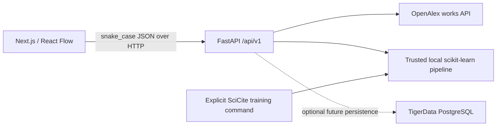

# Architecture

## Frontend

`apps/web/src/app` defines the App Router entry point and global styles. `components/layout` owns the workspace, `components/graph` wraps React Flow, and `components/papers` displays paper metadata. `hooks/use-research.ts` owns request state and cancellation. `lib/api.ts` owns HTTP transport and structured errors. `lib/types.ts` mirrors Pydantic models.

The initial page renders an empty canvas before making external-data requests. A health check establishes backend communication. Search results come from FastAPI. Selecting a result creates one real paper node and populates details from that result. React Flow provides pan, zoom, background and controls. Graph expansion is a later vertical slice.

## Backend

`app/main.py` constructs the app, registers routers, configures CORS and installs consistent error handlers. A lifespan-scoped HTTPX client shares connections. Pydantic Settings reads `apps/api/.env` using an absolute path derived from source location. `app/dev.py` makes root and backend-directory startup behave consistently.

`services/openalex.py` owns provider requests, normalization and bounded retries. Full OpenAlex URLs normalize to work IDs. Inverted abstract indexes reconstruct provider-supplied abstract text. Missing fields remain nullable. Search is the first external-data feature. Metadata, references, incoming citations and graph expansion should extend this service boundary.

`schemas/contracts.py` defines papers, citations, graphs, search, classification and intended save requests. Citation arrows always run from citing to cited works. Intent requires genuine context and confidence. Unclassified citations carry null intent and confidence.

## Training and inference

`ml/train.py` explicitly loads local SciCite JSONL using Hugging Face datasets, fits TF-IDF plus logistic regression and serializes a single sklearn Pipeline containing both fitted stages. `ml/evaluate.py` reports held-out metrics, majority baseline and confusion matrix. Model generation is independent of API startup.

The inference service lazily loads `citation_pipeline.joblib` on the first classification request. Missing or incompatible artifacts produce HTTP 503. Install artifacts from a trusted team training run. joblib deserialization executes Python objects. Model dependencies belong in runtime, while data loading and plotting dependencies belong in the optional training group.

## Optional database

`db/models.py` defines a PostgreSQL JSONB snapshot table. `db/session.py` lazily creates a SQLAlchemy engine and session dependency. Alembic runs explicitly with a configured URL. Health, OpenAlex search and model inference never request a database session.

Persistence routes are HTTP 501 pending authenticated ownership. The proposed owner column is a future server-verified principal. Saved snapshots will include canonical graph data, positions, expanded work IDs, settings, filters and citations with their evidence sources.
